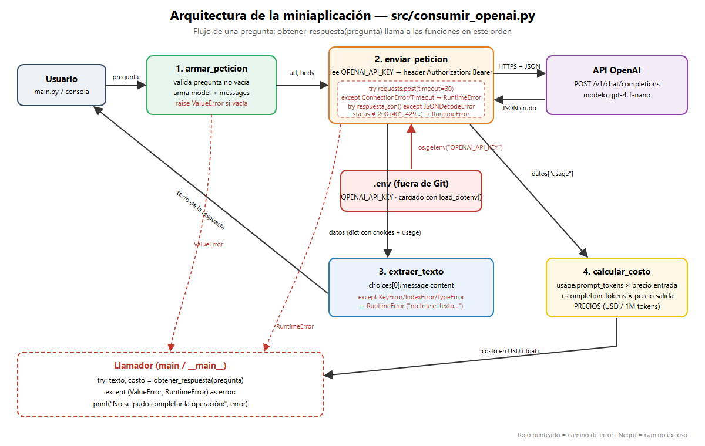

# Decisión de arquitectura: elección de modelo

- **Fecha:** 22-10-2026
- **Estado:** aceptada
- **Autor:** Enzo Gatica

## Contexto

La miniaplicación es un asistente que redacta respuestas a consultas de clientes de pymes (panaderías, ferreterías, cabañas) de Tomé y Dichato que llegan por WhatsApp o Instagram. Las respuestas son cortas (una a tres frases), el volumen esperado es de cientos a pocos miles de consultas al mes por negocio, y el dueño del negocio revisa el texto antes de enviarlo.

## Modelo elegido

**`gpt-4.1-nano`** de OpenAI, vía `POST https://api.openai.com/v1/chat/completions`.

## Diagrama de arquitectura

El diagrama (fuente editable: [`diagrama_arquitectura.svg`](diagrama_arquitectura.svg)) muestra el recorrido `armar_peticion → enviar_peticion → extraer_texto → calcular_costo`, dónde se usa `OPENAI_API_KEY` y dónde se captura cada error. El modelo elegido aquí es el valor de `MODELO` en `src/consumir_openai.py`.

## Comparación de candidatos

Datos reales medidos el 22-10-2026 con [`src/comparar_modelos.py`](../src/comparar_modelos.py): 5 peticiones por modelo con la misma consulta de cliente ("¿hacen tortas para 30 personas con despacho a Dichato?"). Precios de la página oficial de OpenAI; costo calculado con los tokens reales de `usage` de cada respuesta.

| Modelo | Precio entrada / salida (USD por 1M tokens) | Latencia promedio (s) | Tokens de salida promedio | Costo promedio por request (USD) | Costo por 1.000 requests (USD) |
|---|---|---|---|---|---|
| gpt-4.1-nano | 0.10 / 0.40 | 0.87 | 41 | 0.0000209 | 0.0209 |
| gpt-4.1-mini | 0.40 / 1.60 | 0.99 | 36 | 0.0000763 | 0.0763 |

Respuesta de ejemplo de cada uno, para la misma consulta:

- **gpt-4.1-nano:** "¡Hola! Sí, hacemos tortas para 30 personas y podemos despacharlas a Dichato. ¿Qué tipo de torta le gustaría? Quedo atento para confirmar detalles. ¡Gracias!"
- **gpt-4.1-mini:** "¡Hola! Sí, hacemos tortas para 30 personas y realizamos despacho a Dichato. ¿Qué tipo de torta te gustaría? Estamos para ayudarte."

## Justificación

El criterio que más pesó es el **costo**, porque el cliente final es una pyme que paga una mensualidad baja y el asistente responde muchas consultas cortas. `gpt-4.1-nano` cuesta ~3,7 veces menos por petición (USD 0,02 vs 0,08 por cada 1.000 consultas) y en esta medición además fue más rápido (0,87 s vs 0,99 s). Para consultas cortas de atención al cliente la calidad fue equivalente: ambas respuestas son correctas, amables y accionables, y el dueño las revisa antes de enviarlas.

## Alternativa descartada y por qué

**`gpt-4.1-mini`**: su calidad extra no se nota en respuestas de dos frases y cuesta casi cuatro veces más sin ganar latencia. Queda como opción de respaldo si en el Módulo 2, al sumar RAG con documentos del negocio, `nano` empieza a ignorar el contexto recuperado; cambiarlo es modificar una sola constante (`MODELO`).
